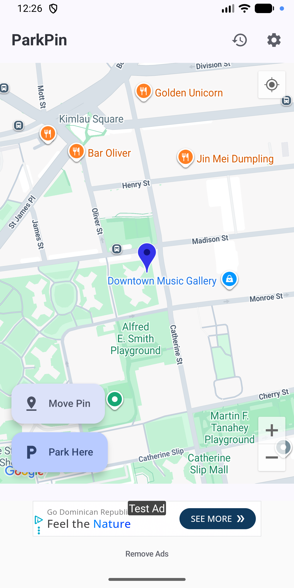
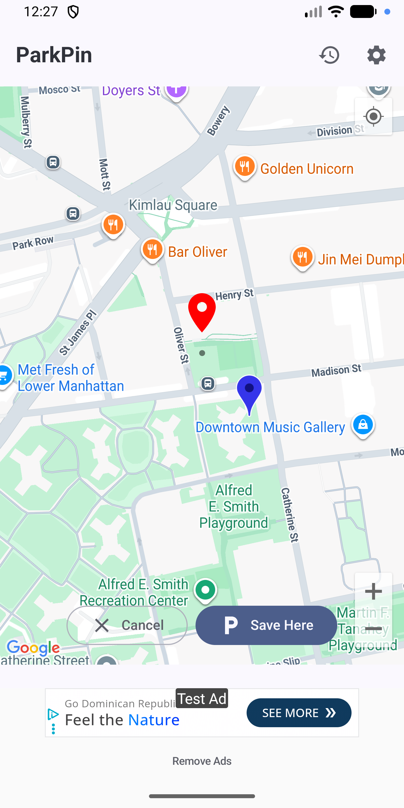
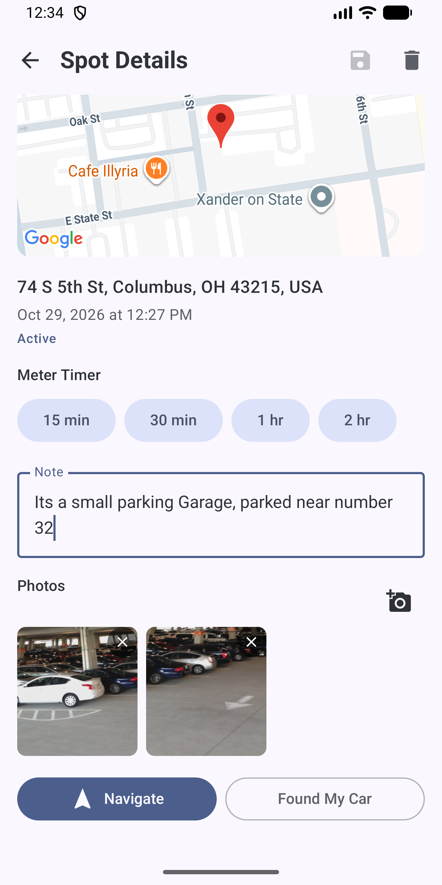
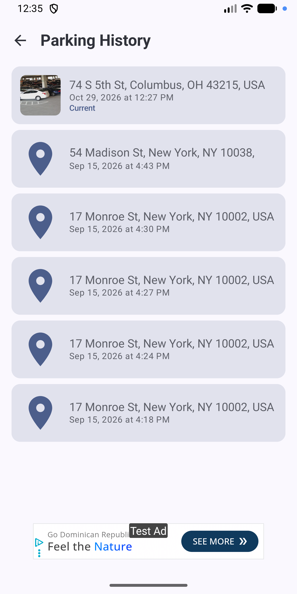
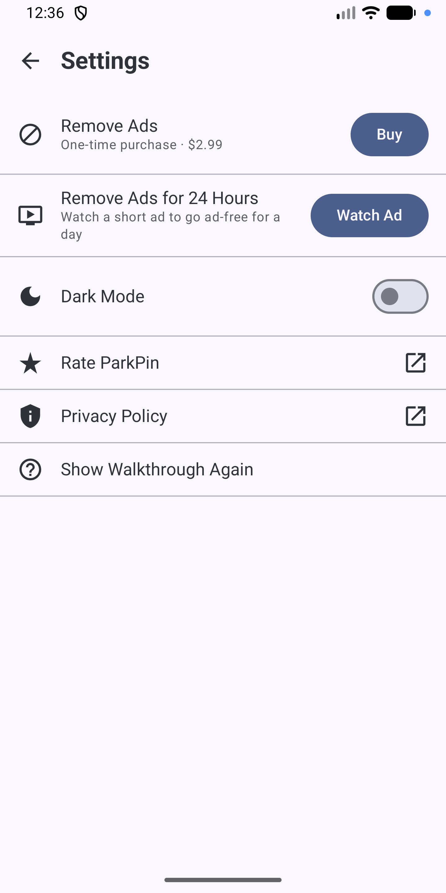

# ParkPin

**Never forget where you parked.** ParkPin is an Android app that saves your car's location, helps you get back to it, and keeps a history of everywhere you've parked.

[**Get it on Google Play**](PLAY_STORE_LINK) · [Privacy Policy](PRIVACY_POLICY_LINK)

> The source code for ParkPin is kept in a private repository. This repo is a showcase of what the app does and how it's built.

<table>
  <tr>
    <td></td>
    <td></td>
    <td></td>
  </tr>
  <tr>
    <td></td>
    <td></td>
    <td></td>
  </tr>
</table>

## Features

- **One-tap parking.** "Park Here" grabs a fresh high-accuracy GPS fix and saves it as your current spot.
- **Manual pin placement.** Already walked away from the car? Pan the map to where you parked and save the spot from there instead of using GPS.
- **Automatic addresses.** Each spot is reverse-geocoded in the background, so you see a street address as soon as it's available.
- **Notes and photos.** Jot down the level, row, or landmark, and snap photos of where you parked. Notes autosave as you type.
- **Meter timer.** Start a 15-minute, 30-minute, 1-hour, or 2-hour countdown for a parking meter. The timer is shown in the app and doesn't send background notifications.
- **Navigate back.** Launches turn-by-turn directions to your car in Google Maps.
- **History.** Every past spot is kept, newest first, with its address, date, and photo. Swipe to delete.
- **Dark mode**, Material You dynamic color, and a first-run walkthrough you can replay from Settings.
- **Works on more devices.** Camera and GPS are optional hardware features, so ParkPin installs on devices that lack either.

## Monetization

ParkPin is free and ad-supported (AdMob banner and interstitial ads, with frequency caps). Users can remove ads permanently with a one-time in-app purchase, or watch a rewarded ad to go ad-free for 24 hours.

## Tech stack

| Area | Technology |
|---|---|
| Language | Kotlin |
| UI | Jetpack Compose, Material 3 |
| Architecture | Single-activity, Hilt dependency injection, repository pattern |
| Navigation | Navigation Compose with type-safe routes (`kotlinx.serialization`) |
| Persistence | Room (with schema migrations) |
| Maps and location | Google Maps Compose, Fused Location Provider |
| Camera | CameraX |
| Images | Coil |
| Monetization | AdMob, Google Play Billing, Play In-App Review |
| Build | Gradle (Kotlin DSL), KSP |
| Android support | Min SDK 26 (Android 8.0), target SDK 36 |

## Design notes

- **History is never lost by accident.** Only one spot can be active at a time. Parking somewhere new deactivates the previous spot and moves it into history instead of deleting it.
- **One data-access layer.** Every ViewModel goes through a single repository for spots, photos, notes, and meter timers. Deleting a spot also removes its photo files from disk, so the database and storage stay in sync.
- **Ads that don't get in the way.** Interstitials are capped per session, per day, and by a cooldown. A single "show ads" state combines the permanent purchase and temporary rewarded-ad grants, and refreshes itself so a temporary grant expiring doesn't need an app restart.
- **Prompts don't pile up.** The "Remove Ads" prompt appears at most once per session, and the Play Store review prompt appears at most once per install, only after several successful finds. If both would fire at once, the purchase prompt wins.
- **Local storage.** Spots, notes, and photos are stored on the device, and no account is required.

## Contact

Questions or feedback? Reach me through [zstehura.com](https://zstehura.com) or [@Zstehura](https://github.com/Zstehura) on GitHub.
